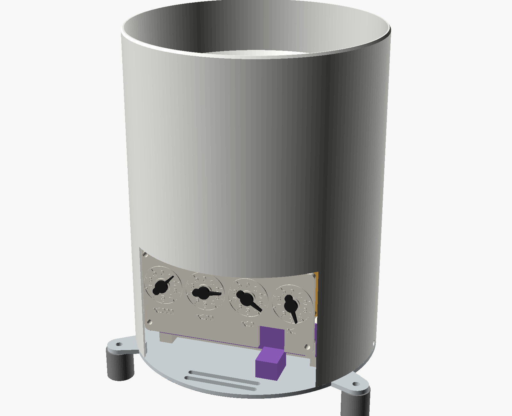
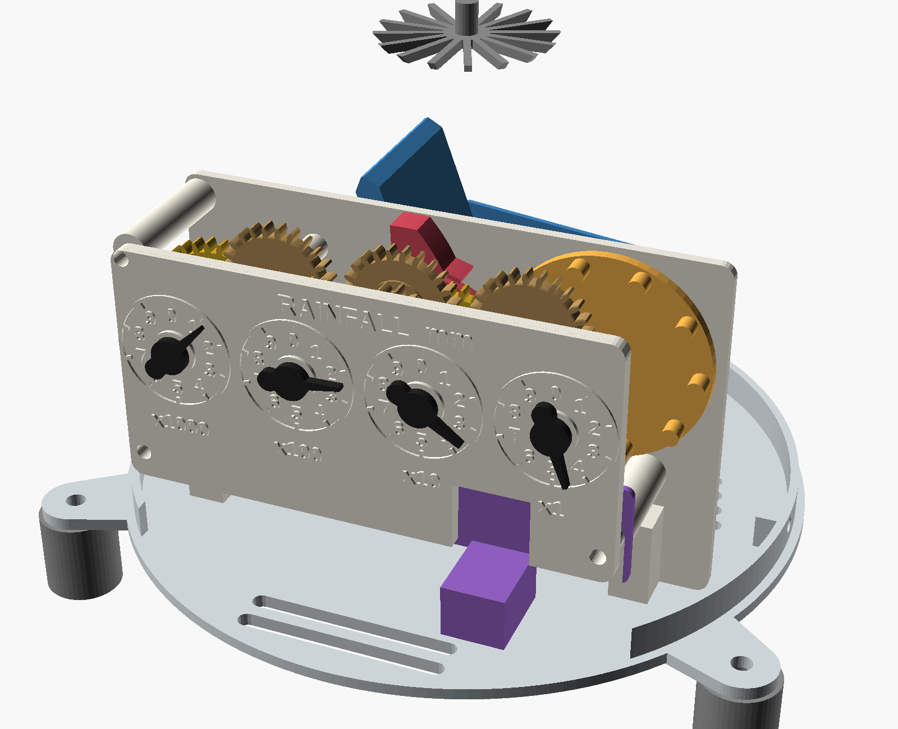
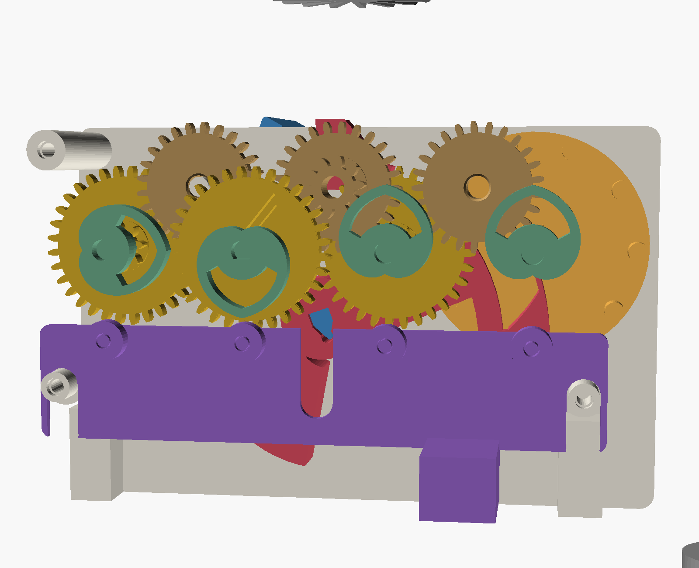
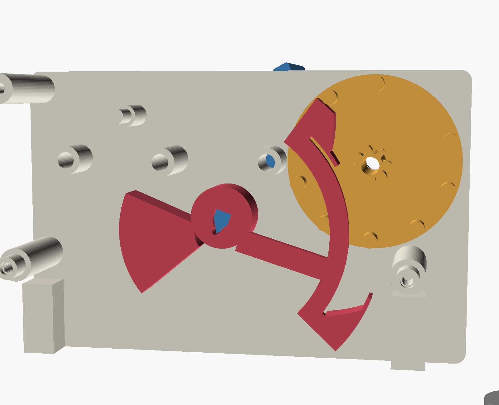
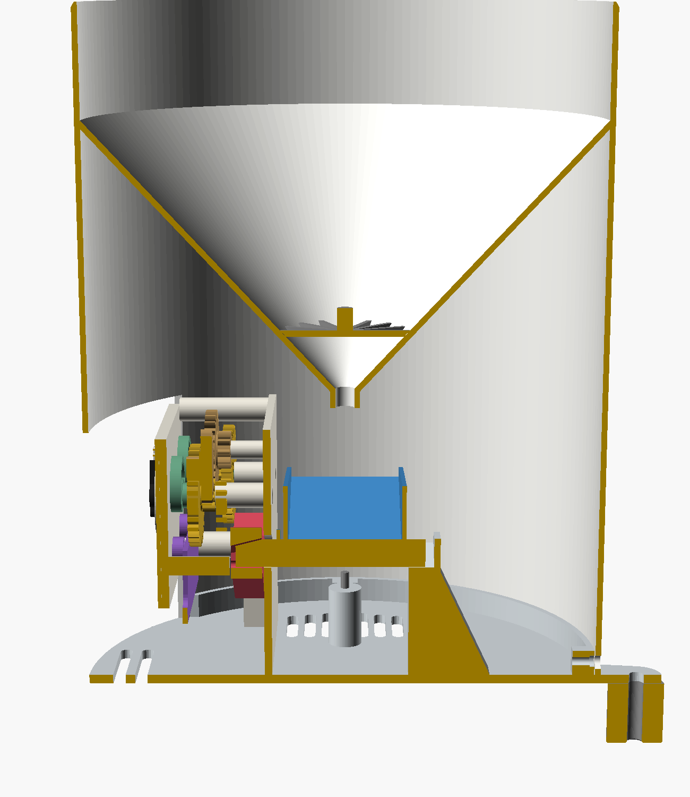

# Mechanical Rain Gauge (Fable 5.2)

A fully mechanical tipping-bucket rain gauge. It totals rainfall in millimetres on four
clock-dial pointers, like an old gas or electricity meter, and reads **0 to 9999 mm**. One lift of
a tab under the dials returns every pointer to zero. There are no electronics, magnets or springs:
the falling water does the counting.

| | |
|---|---|
| Collector | Ø159.6 mm = **200 cm²**, the WMO lower bound and the Hellmann standard. 1 mm of rain = 20 ml |
| Bucket | tips every **10 ml = 0.5 mm**; two M3 screws calibrate it |
| Register | four dials ×1000, ×100, ×10, ×1 mm, 10:1 between neighbours, all clockwise; 20 tips turn the ×1 pointer once |
| Reset | lift the tab: four rollers drive four heart cams and every pointer returns to 0 |
| Size | Ø163 × 233 mm on its feet (177 × 183 mm over the mounting ears) |
| Printed parts | 31 pieces from 17 designs, PETG, no supports |
| Printer | Bambu Lab X1 Carbon, 0.4 mm nozzle; largest part is the collector, 163 × 163 × 211 mm |
| Hardware | ten M3 screws and three 4 × 40 mm mounting screws (list below) |

**Status: designed and verified in CAD, not yet printed.** The geometry, the fits between every
pair of parts, the step-by-step motion of the drive and the bucket's tipping point are checked by
the model itself (see [Verification](#verification)). Friction, wetting and print tolerance are
not, so expect to calibrate it and to report back what a real print does.

## How it works

1. **Collector.** Rain lands in a round collector with a sharp rim that is vertical inside and
   bevelled outside. A 35 mm vertical wall stops drops splashing out, and a 47° funnel leads to a
   6 mm nozzle. The collector is one piece with its skirt, an upturned bucket that drops over the
   base and shelters the mechanism. A window in the skirt shows the dials.
2. **Tipping bucket.** A flat see-saw with a central mast sits on two printed knife edges. It rests
   tilted 20° on an M3 stop screw, with the raised half under the nozzle. The mast is solid
   ballast: its weight holds the bucket down until 10 ml has collected, then the water's weight
   wins, the bucket tips, pours through the drain slots, and the other half starts filling.
3. **Drive.** The bucket carries an anchor with two pallets, which straddles a wheel of ten pins.
   Each swing withdraws one pallet and pushes the other between two pins, and its ramp moves the
   wheel half a pin pitch (18°). The last part of the swing is dwell, where the pallet only locks
   the wheel, so the stop screws can be adjusted without changing the step. It is a clock
   escapement run backwards: the anchor drives the wheel.
4. **Gear train.** The pin wheel carries the ×1 pointer. From there each dial drives the next
   through an idler: 8 → 25 teeth, then 10 → 32, which is exactly 10:1. Two meshes per stage means
   every pointer turns clockwise.
5. **Clutch and reset.** Each pointer is pressed into a rotor whose arbor passes through its gear.
   A small cantilever inside the gear drags on the arbor, enough to carry the pointer round but
   weak enough to slip. Behind each dial the rotor has a heart-shaped cam. Lifting the reset tab
   raises a bar with four rollers; each roller pushes its cam round until it drops into the cusp,
   which is zero. The gears stay where they are, locked by the anchor (the wheel can creep within
   its 1.7° of end play, which the next tip takes up). The cam is an Archimedean
   heart, which lifts the roller the same 2.9 mm per radian wherever it touches, so the push keeps
   turning the cam even with dry plastic rubbing on plastic.

## Research behind the design

**Collector size.** WMO-No. 8 (Guide to Instruments and Methods of Observation, vol. I ch. 6) says
the orifice area is not critical for rain, that 200 to 500 cm² is the most convenient range, that
the rim should be sharp, vertical inside and steeply bevelled outside, that the area should be
known to 0.5 %, and that a deep vertical wall and a steep funnel prevent splash. The German
Hellmann gauge is 200 cm² (159.6 mm) and is sold as the "WMO standard"; RIMCO and R. M. Young also
treat 200 cm² as a standard size. National gauges differ (US and Australia 8 in / 203 mm, UK
5 in / 127 mm), and Davis (214 cm²) and Texas Electronics (6.06 in) sizes are makers' own. So
200 cm² is the standard nearest the suggested 150 mm, and it makes 1 mm of rain a round 20 ml.

**Tip size.** WMO recommends a tip of no more than 0.2 mm, and commercial gauges offer 0.1 to
0.5 mm. This gauge uses 0.5 mm because the bucket has to do mechanical work: a 10 g charge of
water turns a printed register with margin, and a 4 g one would not. Tipping buckets under-read in
heavy rain because water keeps arriving during the tip (WMO: appreciable above 100 mm/h; Duchon et
al. measured about 1 % at 20 mm/h and 9 % at 175 mm/h on one gauge). A larger bucket tips less
often, which helps.

**History and precedents.** Christopher Wren showed a self-emptying tipping vessel to the Royal
Society in 1662, and Hooke built it into his weather-clock. Negretti & Zambra sold a tilting-bucket
gauge in which each tilt advanced a toothed escapement wheel carrying a dial, and Keuffel & Esser
a "zero setting" gauge with a geared double dial. Those are the direct ancestors of this drive.

| Patent | Year | What it shows |
|---|---|---|
| US 27,118 (Farrar), Water-meter | 1860 | a tilting box works a pawl and "ratchet or escapement wheel" that turns a dial train |
| US 183,416 (Plymale), Water-meters | 1876 | two-compartment tilting tank advancing a ratchet register |
| US 3,127,769 (Stucky), Rain gage | 1964 | escapement-stepped rotor geared to dial hands, with a friction-fit resettable hand |
| US 5,898,110 (Hagstrom), Precise rain gauge | 1999 | static calibration by pouring a known volume and counting tips |
| US 487,908 (Tobey), Gas-meter register | 1892 | gear train driving pointers on decimal dials |
| US 809,127 (McDonald & Scofield), Station-meter index | 1906 | each full turn of one dial moves the next one point |
| US 670,075 (Heinitz), Returning device for calculating-machines | 1901 | heart-shaped discs return register wheels to zero |
| US 3,248,051 (Kelch), Heart cam resetting devices | 1966 | the dead-centre problem when the lever meets the cam tip |
| US 825,424 (Scribner), US 1,459,425 (Wheeler) | 1906, 1923 | telephone message registers stepped by an armature pawl |

Heart-cam reset is usually credited to Adolphe Nicole's chronograph (1844, 1862); those patents
are not on Google Patents, so that attribution rests on secondary sources.

**Where this design departs from the old meters.** Gas and electricity registers use one
pinion-and-wheel mesh per stage, which is why their neighbouring dials turn in opposite directions.
A single 10:1 mesh at a printable tooth size needs an 80 mm wheel, so this register uses two
meshes per stage instead. It is smaller, and every dial reads clockwise.

## Print

Open the `.3mf` files in Bambu Studio or OrcaSlicer: the print settings are already applied.
The `.stl` files are the same parts for any other slicer.

| File (`mechanical-rain-gauge-…`) | Qty | Settings | Notes |
|---|---|---|---|
| `collector` | 1 | 0.2 mm, 4 walls, 20 % | prints rim-down, 211 mm tall. **8 mm outer brim**, slow outer walls; trim the brim flush |
| `base` | 1 | 0.2 mm, 4 walls, 20 % | |
| `bucket` | 1 | 0.2 mm, **100 % infill** | its mass sets the calibration. No brim on the knife edges; do not sand them |
| `anchor` | 1 | 0.2 mm, **100 % infill** | it is balanced about the pivot |
| `back_plate` | 1 | 0.2 mm, 4 walls, 20 % | |
| `dial_plate` | 1 | 0.2 mm, 4 walls, 20 % | prints face down |
| `dial_card` | 1 | 0.2 mm | **change filament at 1.2 mm (layer 7)** for contrasting numerals |
| `slide` | 1 | 0.2 mm, 4 walls, 20 % | reset bar and tab |
| `plate_extras` | 1 plate | 0.2 mm, 4 walls, 20 % | three feet, and the optional leaf guard: a spoked star that sits in the funnel and lifts out by its knob |
| `plate_register` | 1 plate | 0.16 mm, 100 % infill | 3 clusters, 3 idlers, pin wheel, 3 long rotors, 1 short rotor, 4 pointers, 4 rollers |

Single-part STLs (`units_wheel`, `cluster`, `idler`, `rotor_long`, `rotor_short`, `pointer`,
`roller`, `foot`, `leaf_guard`) are there for reprinting one piece. Use PETG throughout, white or light for the
collector and base. Dry the filament before the gears and clean any strings from between the teeth.

**Hardware:** M3 × 10 pan head × 3 (dial plate), M3 × 10 countersunk × 2 (register feet),
M3 × 20 socket head cap × 2 (calibration stops, turned with a 2.5 mm hex key), M3 × 8 pan head × 3
(collector skirt), and three screws about 4 × 40 mm for the mounting ears and feet. All the M3 screws cut their own thread in the plastic: drive
each one in and out once before assembly.

## Assemble

Build the register face down on the bench.

1. Lay the dial card face down and the dial plate on it, posts up. Push each pointer's stub up
   through both and press a rotor onto it, cam against the plate, with the flats aligned. The
   **short-collar rotor goes on the ×100 dial** (third from the right as you will read it).
2. Set the four rollers on the plate below the cams and lower the reset bar so its posts enter
   them. Its centre slot goes over the post beside the ×10 dial.
3. Add the gears from the front plane backwards: the ×100 cluster (big gear first) and the idler
   beside it (pinion first); then the ×10 and ×1000 clusters (pinion first) and the idler between
   ×1 and ×10 (gear first). Rest the third idler (gear first) in mesh between ×100 and ×1000.
4. Lay the anchor on the centre post with its pallets up, then lower the pin wheel onto the ×1
   arbor, pinion first, so its pins drop either side of a pallet.
5. Lower the back plate so that its post finds the third idler, the four arbors enter their
   bosses and the stepped standoffs pass through the reset bar. Turn it over and fit the three
   M3 × 10 screws through the card. Check that the tab lifts and falls freely and that turning the
   pin wheel by hand moves the ×1 pointer.
6. From behind, pass the bucket's neck through the keyhole in the back plate and push it into the
   anchor hub until it seats. The bucket and anchor now rock as one.
7. Lower register and bucket together onto the base, the bucket's rear knife edge into the slot
   in the post, and fix the feet with two countersunk screws from below.
8. Screw the two M3 × 20 calibration screws up through the bosses until the bucket rests at about
   20° each way. Fit the collector over the base with its window over the dials and add the three
   skirt screws. Drop the leaf guard into the funnel if you want it.
9. Mount the gauge level, with a foot under each ear and a screw through each. The feet lift the
   base 20 mm so the drain slots run free and a hex key still reaches the calibration screws.

To clean the bucket in place, lift the collector off. To take the bucket out, undo the two foot
screws, lift the register out with the bucket, and pull the bucket backwards out of the anchor.
Once the collector is on, the bucket cannot jump off its pivots: the nozzle stops it first.

## Calibrate

The model predicts 10.0 ml per tip at a 20° rest tilt, changing by about 0.6 ml per degree, with
each stop screw adjusting its own side. Plastic density, wetting and friction will move the real
figure, so calibrate with water:

1. Level the gauge. Wet the funnel and bucket first and let them drain.
2. Pour **200 ml** in slowly, a thin trickle over 5 to 10 minutes (a bottle with a pinhole in the
   cap works). That is 10 mm of rain: the ×1 pointer should make exactly one turn, 20 tips.
3. Too few tips: the bucket is holding too much, so lower the tilt by turning both screws **up**
   (clockwise seen from below, with a 2.5 mm hex key) a quarter turn, which is about 0.2° or 1 %. Too many: turn them down.
   To even out the two sides, catch and weigh one tip from each.
4. The drive needs a tilt between 18.5° and 21.5° (about ±8 % on the volume). If your bucket
   needs more than that, change `bk_mast_h` (about 0.25 ml per mm) and reprint the bucket.

Measure your printed rim too: PETG shrinks about 0.5 %, which is 1 % on area. If the inside
diameter is `d` mm, pour `0.7854 × d² / 100` ml instead of 200.

## Read and reset

Read the dials left to right like a meter. If a pointer is between two numbers take the lower one;
if it sits on a number, look at the dial to its right and take the lower number unless that dial
has passed 0. The ×1 dial reads to half a millimetre, one tip.

To reset, lift the tab under the dials as far as it goes and let it drop.

## Verification

Every claim above is tied to something that is checked when the model compiles.

- **Gate:** `verify-model.py` builds all 36 parts and views with OpenSCAD 2026.11.12. Every printed
  part is one manifold body on the bed and inside 256 mm; the base is 177 × 183 mm, inside the
  220 mm area that clears the X1C's exclusion zone.
- **Interference:** six `clash_*` parts intersect every pair of the 27 assembled pieces (351 pairs)
  at rest, mid-swing handover, mid-push, end of travel, return stroke and reset, with the pointers
  at different readings. Four more check the anchor against the pin wheel at in-between angles.
  All render empty, and a deliberate mis-pose of the wheel is caught.
- **Drive kinematics:** `calc/escapement.py` swings the anchor in 0.05° steps and lets the pallets
  push the pins. Each tip advances the wheel 18° in both directions (72° in four tips), pushing
  from 4° to 15° of the swing, so it is finished 3.9° before the earliest stop.
- **Tip volume:** `calc/bucket.py` takes the bucket's mass and centre of mass from the exported STL
  and solves the moment balance: 26.7 g, centre of mass 14.3 mm above the pivot, 10.0 ml at 20.0°.
  The water gives up about 2.4 mJ per tip; stepping the wheel takes about 0.03 mJ.
- **Balance:** `calc/balance.py` puts the anchor's centre of mass within 0.03 mm of the pivot, a
  bias of 0.3 g·mm against the bucket's 130 g·mm holding moment.
- **Reset:** the cam's lift is compared with the friction of the roller on its post and the rotor
  in its journals at a coefficient of 0.35: 1.6 mm of torque arm is left at the cusp and 0.6 mm
  at the tip.
- **Clutches:** beam theory gives 0.10 N·mm of drag at worst (soft plastic, low friction, half
  lost to creep) against the 0.03 N·mm needed to carry a rotor, whose cam is windowed to halve its
  imbalance to 1.9 g·mm. At best the drag is 0.59 N·mm, which the reset overcomes with 0.9 N per dial.
- **Contracts:** 32 `assert()`s in `rg-assembly.scad` cover the orifice area, the 10:1 ratio, gear
  contact ratios (1.22 and 1.27), printable tooth tips, cam and roller geometry, the reach of the
  calibration screws, end stops for the idlers, nozzle clearance and the size limits. Changing a parameter that breaks one stops the build.

Only a print can confirm these:

- that the clutch beams drag enough to carry the pointers and little enough to reset (they are
  sized for about 0.3 N; PETG creeps, so the drag will fall over the first weeks);
- that the knife edges and the 1 mm pallet blades print cleanly, and that the knife seats in a
  printed V whose corner is not perfectly sharp (a few tenths of a millimetre of pivot height);
- the pointer press fit and the tapered seat between the bucket's neck and the anchor;
- that the 211 mm collector stays on its 0.9 mm rim for the whole print;
- real tip volume, and how much water clings to the bucket;
- under-reading in heavy rain, which is not modelled.

Known limits: nothing holds the wheel against turning backwards for part of each swing except its
own friction, so strong vibration could lose a half-count; the dials have no window, and 2 mm gaps round the dial plate let driven rain reach the gears;
the funnel's rain side prints as an overhang and may hold drops until rubbed smooth; the base
floor is flat, so it stays damp after rain.

## Files

| | |
|---|---|
| `mechanical-rain-gauge.scad` | parameters, header and part selector |
| `rg-lib.scad`, `rg-register.scad`, `rg-wet.scad`, `rg-assembly.scad` | gears and helpers; the register; bucket, base and collector; poses, clash checks and contracts |
| `calc/escapement.py`, `calc/bucket.py`, `calc/balance.py` | drive kinematics, tip volume, anchor balance |
| `calc/find-clash.sh`, `calc/stl_tools.py` | diagnostics |
| `mechanical-rain-gauge-*.3mf`, `*.stl` | Bambu Studio projects and meshes |

## Design history

| Version | AI model | Date | Change |
|---|---|---|---|
| v1 | claude-fable-5-2 (design review: claude-sonnet-5-5) | 2026-11-14 | Initial design |
